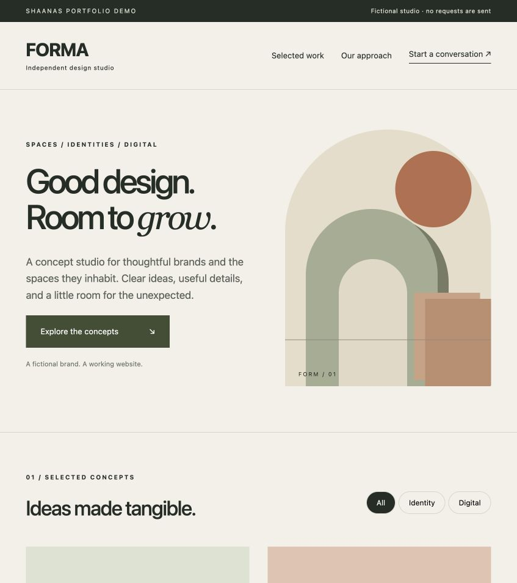

# FORMA — Studio website demonstration



A responsive website for a **fictional design studio**, created from scratch for the ShaAnas portfolio. All brands and project concepts on this page are illustrative; they are not client references.

## Demonstrates
- Editorial layout and responsive CSS artwork, without external fonts or assets.
- Filterable project concepts with accessible pressed states and status announcements.
- Browser-validated enquiry form and safe text-only result rendering.
- Keyboard navigation, skip link, reduced-motion support, and mobile layout.

## Run
Requires Python 3. From this directory:
```sh
python3 -m http.server 8000 --bind 127.0.0.1
```
Open http://127.0.0.1:8000. No installation or build is required.

## Try it
1. Filter the work by Identity or Digital, then restore All.
2. Use the enquiry form with `Alex Demo`, `alex@example.com`, and a fictional project.
3. Submit an invalid email or an incomplete form to see validation.
4. Resize to a phone width and navigate using the keyboard.

## Data and scope
The form never submits to a server, sends email, or persists input. Use fictional details. This is a frontend demonstration; production lead storage, spam protection, consent handling, analytics, and delivery integrations are outside its scope.

## Files
`index.html` contains the page, `style.css` the layout and artwork, and `app.js` the filtering and enquiry preview. No dependencies, credentials, trackers, client material, or ShaNas Core code are included.

Built by [ShaAnas](https://shaanas.com). Public portfolio demonstration; no license grant is implied.

## Validation recorded
Checked on 2026-10-16: browser walkthrough at desktop and 390px mobile width; no horizontal overflow. Project filtering and synthetic enquiry preview verified.
